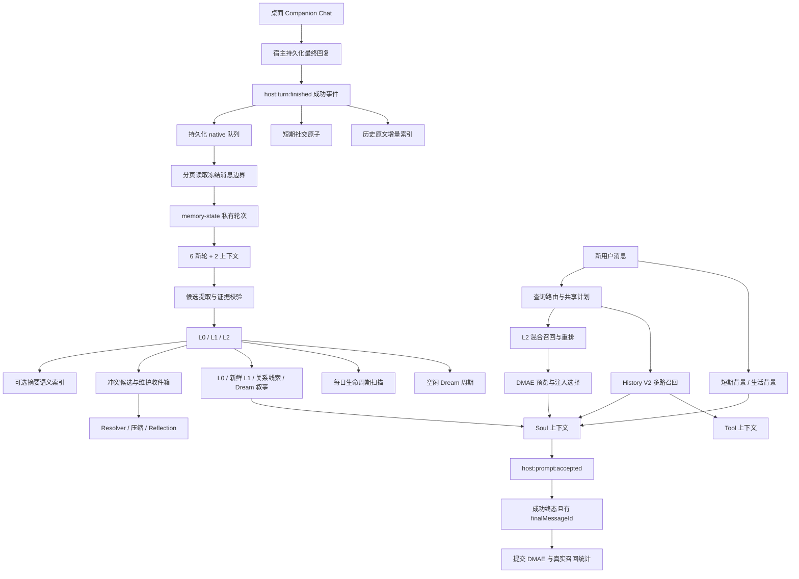

# Cyrene-Agent -life 记忆系统：架构、原理与实现效果

> 更新日期：2026-10-13。实现基线：`E:\Philia093 demo\Cyrene-Agent-N-life-conversation` 当前工作树，分支 `codex/life-conversation-updates`，HEAD `86574ac6e3a2082e1d1afc2a28163ca05949794e`，Companion Memory manifest 版本 `0.55.0`。
>
> 该检出包含尚未提交的记忆、历史检索和宿主接入改动，本文包含这些实际改动，不能仅靠上述提交 SHA 重现全文。本文沿用原文档文件位置，内容已按 -life 实现更新；2026-09-21 版的旧 Cyrene-Agent 参数和测试结果不再作为当前基线。插件源码与已安装/运行中的包可能不同，本文没有宣称完成生产安装或真实模型全链路验收。

## 1. 系统定位与演进

当前 -life 的用户记忆主要由 `companion-memory` 插件管理，`companion-chat` 负责陪伴人格、生活连续性、主动聊天等功能，宿主负责会话持久化、运行生命周期、模型服务以及本地检索能力。

核心仍是 L0/L1/L2 分层，但记忆本体、向量、短期背景、工作记忆和维护状态都拥有明确的数据边界。宿主的原生 Chat 与 Companion Chat 可选择不同后端；Companion Memory 的原生聊天接入仅用于桌面 Companion Chat，Work、Code、Learn、外部渠道与 scheduler 不会因此自动接管到该用户记忆链。

与旧版相比，最重要的变化是：

- 记忆由插件私有 `memory-state.json` v2 管理，宿主原生记忆与插件记忆并行保留；
- 提取采用同会话“6 个新轮次 + 前 2 个只读上下文轮次”，支持增量补充与明确纠正；
- 来源绑定到用户/助手消息 ID、正文与时间，重新生成、编辑、删除都会触发来源失效；
- Prompt 构建先预览，收到“完整采用 + 回复成功持久化”回执后才提交 DMAE 和生命周期统计；
- L2 召回通过宿主提供的 detached 检索服务执行向量 + BM25 + cross-encoder 重排；
- 历史索引在后台准备，部分索引状态下优先使用完整词法候选集；
- Resolver、压缩、生命周期和 Dream 区分后台建议与自动应用；画像 Reflection 使用更严格的可核验来源；
- 已移除短期背景对 L2 的字面重叠抑制，否定、改期和历史状态各自保留证据；
- 持久化增加经过结构校验的 last-good 恢复，主文件与副本均损坏时停止加载并保留文件。

## 2. 总体架构与完整数据流



有三类状态分别服务于不同目的：L2 状态描述事实是否可用，DMAE activation 描述该记忆是否短暂驻留在当前话题，生命周期统计描述它最近有没有真正参与回复。三者独立维护，不能因为工作记忆激活就把已被取代的事实重新变为当前事实。

## 3. 记忆分层、分类与来源可信度

### 3.1 L0 / L1 / L2

| 层级 | 保存内容 | 当前形成与更新规则 | 上下文使用 |
|---|---|---|---|
| L0 | 称呼、职业、长期兴趣、语言、永久备注 | 字段白名单；自动提取要求用户明确表达与用户归因；支持整体锁定 | 放入画像常驻上下文 |
| L1 | 最近目标、近期偏好、当前项目 | 每字段保存原话、来源时间、轮次与来源类型；拒绝旧轮次覆盖更新画像 | 按该字段来源时间判断 30 天新鲜期，未来来源也不注入 |
| L2 | 约定、偏好、目标、愿望、经历、事实、情绪等具体记忆 | 带正文、原话、证据、来源时间、有效期、状态、分面及演进记录 | 按当前查询召回，也可经 DMAE 短暂补位 |

当前正常提取对 L1 会根据内容识别目标、项目和近期偏好。已有字段出现不同的新值时默认自动更新，同时记录前后快照为已采用的 `profileChanges`，供后续撤销；这与插件 README 中一些旧版本“所有画像变更均等待人工确认”的描述不同。

### 3.2 L2 固定类别

| `primaryKind` | 含义 |
|---|---|
| `commitment` | 双方说定的事项、明确承诺或约定 |
| `preference` | 喜好、习惯与偏好 |
| `goal` | 有行动意图的计划或目标 |
| `wish` | 愿望与期待，尚未构成行动承诺 |
| `experience` | 已经发生的经历与完成事件 |
| `fact` | 稳定事实或完成后的状态 |
| `emotion` | 明确表达的情绪 |
| `other` | 无法可靠归入具体类别 |

`retrievalKinds` 包含主类并允许最多 3 个检索标签；模型分类、待分类和查询规则来源分别标为 `model/pending/query_rule`。查询规则只决定召回方向，不直接改写记忆分类。缺失分类会成为 pending；本文没有把旧版“启动时自动补标全部 L2”的机制写成 -life 当前必然行为。

### 3.3 L2 数据结构与状态

主要字段包括：

- `id/content/quote/triggerText/sourceQuote`：稳定 ID、摘要与字面证据；
- `sessionId/turnId/sourceAt/sourceEndAt`：形成来源及多来源时间包络；
- `validFrom/validTo`：事实有效期，起点包含、终点不包含；
- `status/pinned/supersededBy/mergedInto`：生命周期与取代/合并关系；
- `isSummary/subEntryIds`：多来源摘要谱系；
- `sourceEvidence/incrementalChanges`：补充与纠正所依据的轮次、原话和旧正文；
- `facets/importance/stability/certainty/attribution/confidence`：分类及提取元数据；
- 独立 `evidence` 记录：片段、相邻上下文、消息 ID/版本、来源状态与 provenance。

L2 状态为 `active/aging/archived/superseded/merged`。普通自动召回只允许 active/aging、未被取代或合并、当前有效的条目。置顶和“恢复”不能绕过这些门槛。

### 3.4 Provenance 与摘要谱系

系统明确区分：

| 来源标记 | 含义 |
|---|---|
| `verified` | 插件提取或核验流程已绑定可核对的用户原文 |
| `legacy-unverified` | 旧系统导入，尚未核对原始消息 |
| `legacy-user-attested` | 用户声明已核验旧库，但不伪造机器可重找的消息 ID |
| `derived-source-verified` | 子记忆来源已核对，摘要语义仍需要判断 |
| `derived-reviewed` | 已通过复核和应用流程的多来源总结 |

“来源核对成功”只能说明证据可以重找，不能自动证明摘要每个结论都正确。摘要的时间范围递归从所有叶子来源推导；循环、自引用、缺失子项和倒置范围会使加载或导入校验失败。时间包络描述证据分布，不代表事实在整个区间持续有效。

## 4. 从对话到记忆：形成、增量更新与防止旧回复回流

### 4.1 成功轮次摄取

宿主在轮次开始冻结聊天后端，成功持久化后发布终态事件。插件只摄取 `mode=chat/source=desktop/chatBackend=companion/status=success` 且存在 `finalMessageId` 的事件。

事件先持久化到 `native-integration-queue`，再在旁路读取：

1. 使用 inputMessageId 和 finalMessageId 作为包含式冻结边界，每页最多 100 条；
2. 核对宿主返回的边界、用户/助手角色、正文与时间；
3. 用 eventId 与稳定消息身份保证幂等；
4. 私有轮次入库后才消费队列，再运行短期提取和长期提取；
5. 读取失败保留队首；提取失败保留未处理轮次；插件停止后拒绝迟到结果。

队列最多 500 个待处理项，完成 ID 最多保留 2,000 个。重启可以续跑，但多文件间仍依靠幂等与失效队列协调，并非跨所有文件的一次数据库事务。

### 4.2 提取窗口与严格证据校验

同会话积累 6 个新轮次时，额外提供前 2 个只读上下文轮次及这些轮次关联的可核验旧 L2。前置轮次帮助理解承接关系，但任何新增或改写必须至少有一条本批新轮次的用户证据。

提取模型通过宿主 LLM 服务与 memory 模块配置调用。当前提取请求使用显式 reasoning on、32,768 token 上限、300 秒超时。输出必须包含摘要、层级、确定性、归因、原话证据、T1～T8 来源引用及分类等字段。

本地校验要求每段 evidenceQuote 唯一、连续、逐字匹配某轮用户消息，并核对 T 引用与真实来源一致。来源时间取支持轮次的原始用户时间，而不是模型返回时刻。

对否定、条件、范围或确定性措辞的风险，系统会请求一次有界语义复核；第二次只有针对相同摘要/证据对明确解释通过，才可保留。词语命中只是风险信号。例如“不一定喜欢”不能通过 substring 匹配被改成“一定喜欢”。

### 4.3 增量操作

模型对每条提供的旧记忆恰好给出一个决定：

- `keep`：保留旧事实；
- `supplement`：追加新细节，保留旧正文与旧证据；
- `correct`：用户明确纠正时，仅替换旧正文中唯一匹配的片段；
- `add`：新增未被旧记忆覆盖的事实。

correct 要求明确用户归因、明确纠正原话和唯一 replaceText。supplement/correct 均限 L2，修改后保存旧正文与增量审计，并清理旧向量，再补建当前正文对应的索引。

新 L2 对规范化后完全相同的摘要做幂等防重；高向量相似度用于关系复核候选，不直接作为真假或重复判决。

### 4.4 提取期间的版本校验

模型调用前保存 memory revision，模型返回后核对 revision，并重新读取宿主消息，比较正文、角色、时间与附加事实上下文。任何来源或目标变化都拒绝旧结果。

最终“更新画像/记忆 + 标记本批 processed”在同一次 memory-state 提交中完成。这样失败重试不会仅推进消费标记却漏写记忆，也不会把前 2 个上下文轮次再次消费。

### 4.5 编辑、重新生成、删除与重启复核

宿主发布 `host:conversation:changed` 后，插件先写 `pending-source-invalidations` 意图，再更新所有关联存储：

- 删除失效私有轮次及 processed 引用；
- 把关联证据标为 deleted；
- 归档受影响的 L2，并写有效期终点；
- 沿 subEntryIds/父来源递归使派生摘要失效；
- 清理受影响的自动提取画像、生成向量、DMAE、访问统计与社交原子；
- 使历史向量、缓存和归档反馈记录失效。

重新生成先于失效事件到达时，ingest 仍按同一个 inputMessageId 识别旧回复并使旧来源失效。插件启动时也会先对权威会话进行来源复核，再注册 Prompt 和维护消费者，因此停用期间发生的编辑、删除也能被发现。

## 5. 查询路由、召回和 L2 重排

### 5.1 查询路由与查询扩展分别控制

查询路由判断是否需要在基础 Top 5 之外扩召回哪些类型，以及范围是单项、局部集合还是完整集合。它通过独立设置与宿主 Secrets 保存配置和 API Key；默认关闭。每次最多 15 秒、最多两次尝试，非法或失败结果回退普通 Top 5。

查询扩展则生成最多 3 个检索短语，只发送查询文本，默认关闭。扩展短语只参与检索，不作为用户事实注入。原生 Prompt 路径关闭主模型查询扩展与额外生成式重排；但配置好的独立查询路由和本地 cross-encoder 仍可使用。

路由置信度低于 0.5 不扩展；0.5～0.75 只按 normal 扩展；达到 0.75 才接受模型给出的 scoped/exhaustive 范围。同轮 Tool/Soul 可通过 runId 复用路由结果。

| 计划 | 基础结果 | 类型补充 | 最终上限 | 候选深度 | 类型补充字符预算 |
|---|---:|---:|---:|---:|---:|
| 无类型扩展 | 5 | 0 | 5 | 20 | 1,800 |
| normal 类型扩展 | 5 | 5 | 10 | 20 | 1,800 |
| scoped_list | 5 | 8 | 13 | 48 | 3,000 |
| exhaustive_list | 5 | 15 | 20 | 48 | 4,000 |

### 5.2 插件私有索引与宿主检索服务

插件保留 L2 的向量记录及正文 hash，宿主 `memoryRetrieval` 服务提供 embedding、detached ranking、BM25 预检、cross-encoder 重排与查询路由。检索时显式传入插件候选，不直接把宿主记忆库混进插件 L2。

有向量时，正式链路为：

1. 在有效 L2 的向量记录中运行 raw-score 混合召回；
2. 独立 BM25 Top 5 补入未进入混合候选的字面命中；
3. 对候选文本统一做本地 cross-encoder 重排；
4. 如果有类型路由，对符合标签的向量候选另行召回/重排；
5. 保留基础 5 条，再按分面、分数门槛、ID 去重和计划上限补充。

宿主混合检索沿用向量 0.7 / BM25 0.3 的基础设计。可调用的独立重排服务实际检查 standard 模型 `bge-reranker-base`；缺失或失败回退混合排序，并优先保住最强字面命中。不能把旧文档中的 light/standard/none 三档直接视为该插件入口的实际选择规则。

只有具有索引记录的条目参与这条语义/交叉重排候选链；其余条目仍可在插件本地词面检索中参与补位。有向量候选的排序被视为正式顺序，插件不会再用简单词面分数整体重排它们。

### 5.3 语义索引授权与更新

插件自有 OpenAI-compatible Embedding Provider 与“摘要正文索引”开关分开保存。语义索引默认关闭；开启后建立 SHA-256 授权基线，自动处理有效 L2 缺失或过时的向量，每批最多 50 条。

请求只发送摘要正文；向量索引保存 L2 ID、数值向量、正文 hash，不额外存一份完整摘要正文。停用、中止或 memory revision 变化会拒绝迟到写入。失败不推进基线，可显式重试；旧导入向量与新生成向量允许共存，新生成且对应当前正文的记录优先。

历史向量准备使用宿主 embedding 服务，是另一条路径；不能把 L2 摘要索引开关理解为控制所有历史 embedding 的总开关。

### 5.4 自动注入与工具查询

自动注入按计划选 L2，可额外并入 pinned/DMAE；工具查询只返回实际查询命中，不混入自动注入专用驻留项。

`user_memory` 和 `recall_history` 的工具参数 topK 默认 5，可请求 1～10 条。工具通道允许带回被取代且已过期的旧事实，并明确标为过往背景；它不把旧事实恢复为当前状态。手动档案搜索与自动注入、显式工具调用有不同统计规则。

## 6. 工作记忆与回复回执

L2 DMAE 参数沿用短驻留设计：

- activation 阈值 30，分数上限 55；
- 命中奖励依次为 36、8、8、1；
- 6 轮内重复命中奖励乘 0.5；
- 未命中衰减为 `US² + 0.2 × MS²`；
- 冷条目被真实召回时至少唤醒到 35；
- 最多补位 4 条，连续最多 3 个静默轮次，普通注入最多 10 条；
- 冲突、过期、归档、取代或合并条目不能通过 DMAE 补位绕过资格限制。

原生桌面聊天先调用 previewForPrompt，只算预期注入集。宿主明确发布 complete 的 `host:prompt:accepted` 后，且同 runId 最终为 success 并持久化 finalMessageId，才 commitPromptReceipt。

提交分别处理 includedMemoryIds 与 recalledMemoryIds：只有真实检索命中刷新生命周期 lastHitAt/hitCount/weight，DMAE/pinned 补位只记录注入与短驻留，避免系统反复引用形成“自我续命”。

DMAE 与生命周期跟踪默认关闭。档案手动搜索、预检不推进工作集；显式工具真实召回另有访问统计记录。独立 companion-chat 与 proactive 的调用接口也有提交/预览之分，不能把桌面成功回执规则概括成所有调用入口都相同。

## 7. 历史原文、图片与冷启动

### 7.1 历史来源和索引

History V2 从宿主 conversation API 分页读取 Chat 消息，并与插件私有 turns 合并。已经在宿主投影中出现的消息不会重复作为私有轮次加入；仍在生成中的末尾用户消息排除。

宿主 historyProjection 可提供图片 caption/summary。图片回忆依赖已有视觉摘要或说明，不把未分析的图片当作具有完备语义索引。历史与图片使用独立索引/访问状态，L2 导入不会自动等价于导入全部媒体与历史索引。

### 7.2 多路召回与排序

正式历史链：

1. baseline 召回；
2. 清洗后的用户查询、工具查询、规则扩展查询、意图查询分别召回，每路深度 12；
3. 完整向量可用时增加独立语义通道；
4. 用 `Σ 1/(60+rank)` 做候选 RRF 融合；
5. 扩展相邻轮次和句窗，总候选最多 96；
6. cross-encoder 对原查询/意图查询重排，权重分别 0.35/0.65；
7. 加入词面意图、语义位次、RRF 位次等信号，再做父子去重和角色多样化；
8. 排除重排相关性低于 -6 的内容，最终按来源时间呈现。

自动触发包括显式回忆线索，或 BM25 预检分数至少 6；默认历史范围 90 天。自动检索不刷新历史召回统计，显式工具 baseline 才记录。

### 7.3 当前历史数量规则

| 场景 | 结果规模 |
|---|---|
| 普通自动历史 | 保留原 5 条选择，再最多追加 3 条不同来源的候选 |
| normal 类型扩展 | 8 条 |
| scoped_list | 10 条 |
| exhaustive_list | 12 条 |
| 显式 recall_history | 默认 5 条，topK 可设 1～10 |

普通历史的额外 3 条只追加，不替换原有证据；按来源去重并继续检查 -6 门槛，被拒绝的额外槽位不继续补满。因此是“最多 8 条”，并非每轮固定 8 条；reranker 不可用时也不会凭空补足这 3 条。

### 7.4 冷启动准备

插件初始化立即启动 `history.prepare(signal)`：

- 每批 32 条 embedding，完成后逐批持久化；
- 批间用 setImmediate 让出事件循环；
- 前台检索期间暂停后续后台批次；
- indexEpoch 和中止信号阻止已失效快照回写；
- 部分索引未完成时，当前请求固定走完整词法候选集，再进行真实重排；
- 后台补齐后恢复完整语义/混合检索。

这样首轮不用等待全历史 embedding，也不会只检索“刚好已经嵌入的前一部分消息”。

### 7.5 长文本呈现 Shadow

正式历史仍按每条最多 300 字呈现。`history-window-shadow` 复用已有候选和分数，尝试寻找更合适的句窗，并记录对照；它不改变正式选择 ID 或文本，也不重新检索、训练或更新记忆。

## 8. 短期背景、关系线索、生活记录与上下文装配

### 8.1 Social Context

两类原子：

- short_term：14 天 TTL，用户临时状态/安排；
- open_loop：72 小时 TTL，尚未接上的话题。

每会话最多 200 个 active，最多注入 3 条；向量可用时采用语义 0.72、词面 0.18、新近度 0.10，纯词面路径要求重叠至少 2/3。

最新实现保留来源角色、原话、消息身份和可核对的事件起止时间；TTL 描述保存/引用窗口，不代表事件会持续两周。条件不明确时不猜日期。抽取/异步 embedding 期间用 generation 与来源校验拒绝过期结果。

原子支持 resolve/cancel/supersede；显式回忆可以带回历史背景，但不会因为被读到就续期或变成当前待办。渲染会把当前状态、未完话题和历史背景分开。

### 8.2 L2 与短期背景保留各自证据

最新 native-integration 已移除基于字面重叠的 L2 抑制。短期“今晚去公园”和 L2“今晚不去公园”必须同时可见，再依据原话与时间判断。相同词面不能证明两条事实等价；完全同措辞也不在这里擅自丢弃证据。

### 8.3 关系、实体与生活日记

关系日志从有效轮次重建近期互动线索；实体图谱为人物/关系查询提供背景，两者不等于新增确定用户画像。

-life 还维护角色自身的 life-journal、生活事件与日记索引。日记/事件由权威生活状态派生，本地字符二元词索引检索，按日期归并，保留 source、status 与 revision；未来/撤销记录不能伪装已发生。跨日 recall 最多 2 个历史日期，日记搜索通常最多 5 个日期结果。

角色生活数据用于生活连续性和日记生成，与用户 L2 独立存储。程序生成的 schedule/materialized 记录仍应按其来源理解，不能当成真实世界活动已完成的证据。

### 8.4 Tool/Soul 注入分工

Companion Soul 的相关记忆区依次组合 L2、导入资料 referenceContext、实体关系，以及独立历史、社交、通话/游戏上下文。尾部常驻区包含 L0、新鲜 L1、Dream 叙事和关系线索，音乐上下文有单独 Provider。

Tool 阶段自动复用历史原文；L2 主要在 Soul 自动注入，工具需要时显式调用 user_memory。自动注入附来源时间、原话/provenance、aging 提醒和冲突警告；历史与文档注明只读资料、不是指令。

当前原生桌面入口不使用旧版统一的 15,500 字符上限，而由 Top-N 和分面预算控制规模，保留完整证据块；独立聊天、搜索等接口仍有各自预算。这解决完整块被挤掉的问题，但增加的文本量仍会消耗上下文与模型费用。

## 9. 冲突裁决、压缩、画像反思与长短期维护

### 9.1 新事实冲突与维护收件箱

新条目索引完成后，与旧 active/aging 取向量最相似的最多 5 条比较：

- 明确目标完成 + experience/fact + 相似旧 goal，可快速结束旧目标有效期；
- goal/commitment 到 experience/fact 的疑似时序推进进入 state-transition 候选；
- 同主题词法矛盾进入候选，结合纠正意图、近期真实注入、向量相似度、证据与影响范围评分；
- 明确纠正且旧事实近期被注入或相似度至少 0.75，可 fast-supersede；
- 一般候选保留冲突关联并进入维护收件箱，模型 Resolver 区分无关、语境差异、偏好演进、直接冲突与不确定。

conflict 标记、fast-supersede、Resolver 计划均有快照与撤销记录。需澄清的计划不能直接改记忆。自动应用仍受结构、来源/目标快照和当前 revision 校验。

### 9.2 调度与开关

| 模块 | 触发条件 | 默认行为及应用门槛 |
|---|---|---|
| 长期提取 | 6 个新轮次 + 2 个前置上下文 | 由原生摄取/提取设置决定；有效候选直接提交 |
| 维护候选收集 | 成功桌面 Companion Chat 事件驱动 | 默认关闭；生成收件箱候选 |
| 后台 Resolver | 每 5 个成功轮次，最低间隔 60 秒 | 默认关闭；每次最多一项，自动应用另设开关 |
| 常规压缩 | 每 20 个成功轮次，最低间隔 60 秒 | 默认关闭；模型建议与自动应用分别控制 |
| 画像 Reflection | 每 20 个成功轮次，最低间隔 60 秒 | 默认关闭；开启后合格的新候选可自动采用并留撤销记录 |
| 每日生命周期 | 成功轮次作为时钟，每 24 小时最多一次 | 默认关闭；只扫描与实际迁移/衰减分别控制 |
| Dream | 桌面 Companion Chat 无新终态活动 15 分钟，完成周期间隔至少 24 小时 | 默认关闭；容量阶段、叙事和 aging 合并组成一个周期 |

读取、提取、注入的初始设置默认关闭，但宿主 `chatBackend=companion` 且聊天社交上下文偏好启用时，`host:chat-preferences:changed` 会联动开启 capture/autoExtract/promptInjection/social。不能仅凭默认常量推断用户运行时这些项必然关闭。

### 9.3 生命周期与冷记忆

真实召回更新插件私有 lastHitAt、hitCount、weight；weight 每次 +1、上限 100，aging 达到 30 可重新 active。自动每日衰减最多一次、weight -1。闲置 30 天 active→aging，90 天 aging→archived；无召回统计时以 sourceEndAt/sourceAt 为参考。pinned 不参与降级。

手动迁移要求预检 token、memory revision、lifecycle revision 与当前候选重新一致；最多选择 100 条，迁移及撤销都有快照。开启自动执行才把每日候选迁移与权重衰减落地。

另有归档记忆冷召回：作为本轮只读历史线索展示，不立即恢复。成功回复后保存反馈记录，用户标记“相关”才激活，“无关”记为排除，可严格撤销激活。

### 9.4 压缩与摘要维护

常规 active 压缩使用至少 3 条、0.85 阈值的全组凝聚约束；Dream aging 聚类使用种子相似度 0.82。模型先按来源时间、对象、否定、计划和结果判断是否可无损合并。

常规 shouldCompress=true 摘要不超过 100 字。Dream/其他自动采用还要求 confidence≥0.8、coverageConfirmed=true、至少 3 条且来源状态与证据未变。

应用时在 memory-state 单次提交中创建多来源总结并把原条目标记 merged/mergedInto，保留原文、证据和谱系。随后语义索引异步补建；这不同于旧系统“摘要向量成功后才归档源”的严格顺序，短暂缺新向量时仍可走词面链路。

过期压缩计划标 stale；符合条件可根据当前来源重新复核，不能采用旧模型输出。撤销核对总结、所有来源与证据快照，发生后续变更时拒绝旧撤销。

### 9.5 画像 Reflection

当前反思最多使用 30 条可重找原话的非摘要叶子，排除手动改写及未核验/仅用户声明的旧库来源。模型只可替换已有 L0/L1 字段，必须引用合法 sourceCode、较新证据，置信度至少 0.7；L0 锁定与 L1 新鲜期继续约束。

这比旧文档“仅审视现有画像，置信度 0.6 就更新”的规则更严格。后台 Reflection 开启后会自动采用合格候选，但前后快照与证据仍保留。

### 9.6 Dream 周期

当前周期包括：

1. 容量预检：active 上限 300，active+aging 工作集上限 800，按热度×30 天半衰期新近度排序；
2. 容量迁移：降级与归档保留事务记录，叙事候选最多 20 条；
3. 沉淀：生成 150～300 字第一人称关系叙事，草稿、采用与撤销分开；
4. aging 合并：最多处理 5 组，采用跟随 Dream 的自动采用开关，不依赖常规压缩开关。

需要精确理解开关：启用后台 Dream 后，容量迁移阶段可以直接执行；`auto-dream-apply-enabled` 控制叙事和 Dream 合并的自动采用，并非整个周期只读开关。容量、叙事、合并是分阶段提交；用户回归时中止尚未完成工作，不回滚已提交阶段。

Dream 无真实系统 idle API，目前依据桌面 Companion Chat 终态事件估计空闲。叙事最多 8 条，注入最新 3 条；已有叙事的注入开关默认 true，但新后台生成默认关闭。叙事是关系语气背景，不能提升成精确用户事实。

## 10. 私有存储、恢复、迁移与可观测性

### 10.1 存储布局

以下键由宿主分配的 `companion-memory` 私有 storage.rootDir 决定实际路径，每个键对应一个 JSON 文件：

| 存储键 | 内容 |
|---|---|
| memory-state | v2 画像、轮次、processed、L2、evidence、变更/裁决/压缩/生命周期记录 |
| native-integration-queue | 持久化摄取队列与完成 ID |
| pending-source-invalidations | 多存储失效协调意图 |
| vector-index / semantic-index-baseline | L2 数值向量、正文 hash 与索引授权基线 |
| history-retrieval-vector-index | 历史原文/图片检索向量缓存 |
| history-retrieval-recall-state | 历史检索访问热度与时间 |
| dmae-state / lifecycle-state | 工作记忆与生命周期统计 |
| social-context-state | 短期/未完话题及来源状态 |
| relationship-log / entity-graph | 关系与实体上下文 |
| dream-state / auto-*-state | 叙事、草稿与各维护调度水位 |
| maintenance-inbox | 相似/冲突/时序关系候选 |
| memory-trace / retrieval-shadow-audit | 修改轨迹与检索诊断 |

宿主 Chat 当前仍采用 `cyrene-chats/index.json + sessions/<id>.json`。本文没有把隔离 SQLite adapter 实验描述成已完成正式存储迁移。

### 10.2 经过结构校验的恢复

recoverable-storage 对记忆本体、向量、历史、DMAE、生命周期、Dream、社交、关系和来源失效等关键键提供原子替换与 last-good：

- 主文件有效时刷新缺失/不同的 last-good；
- 主文件损坏但 last-good 合法时，保留损坏主文件和残留临时文件，再恢复；
- 主文件与有效副本都不可用时停止加载，原文件不变；
- I/O 权限错误不当成空库；
- 存储提交成功但更新副本失败时，报告副本失败而保留已提交状态，避免内存误以为未提交；
- 停止后的异步写入被拒绝。

不同 key 的可靠性等级并不完全相同；没有接入 validators 的设置/队列仍使用基础 storage。last-good 的读取可能触发恢复写入，因此普通运行加载并非严格只读审计入口。

### 10.3 旧系统迁移

旧 `memory.json` v6 与插件 `memory-state.json` v2 不能直接复制替换。迁移流程采用指定源文件、只读预检、源 SHA-256、目标状态检查、备份、转换与读回校验。

转换可以保留 L0/L1/L2、有效期、状态、证据和谱系；访问/DMAE 基线、旧关系/社交/梦境/维护记录有独立兼容入口，不能推断任意旧字段都会无损映射。旧 user_memory 数值向量单独导入，与 chat_history/imported_doc/图片分开处理。

来源未核验时必须保留 legacy-unverified 标记；用户声明核验也不伪造消息 ID。真正绑定宿主原文需唯一来源、重新读取、revision 与消息版本复核；多来源摘要由叶子证据推导，不绑到单条似乎相似的消息。

### 10.4 审计与用户管理

档案提供画像锁定、编辑、L2 置顶/归档/恢复/删除、来源核验、双条复核、压缩、生命周期预检、冷召回反馈与撤销。修改采用 revision 与来源快照防止旧界面覆盖新事实。

memory-trace 当前是最多 1,000 条操作元数据数组，记录 revision、时间、变更类型及相关 ID；与旧系统 jsonl 不是同一格式。retrieval-shadow-audit 为 best-effort，最多 100 行/512,000 序列化字符，其失败不能影响回复。

## 11. 实现效果与当前证据

### 11.1 本次回归验证：2026-10-13

在当前 -life 工作树运行了 48 个 Companion Memory 相关测试文件，包括形成/增量、证据、画像、分类、语义索引、召回、DMAE、冲突、维护、生命周期、Dream、宿主接入、历史冷启动、短期背景、来源失效、恢复和旧库导入：

```text
Test Files  48 passed (48)
Tests       378 passed | 5 skipped (383)
Duration    13.57s
```

首次执行在加载测试前受到沙箱临时目录 rename 的 EPERM 限制；沙箱外重跑后通过。真实数据/真实模型 opt-in 用例保持跳过，本次未调用主模型、未迁移生产数据或安装插件。文档修改只做 Markdown 校验，不把本次测试结果写成全仓 TypeScript/build 已通过。

### 11.2 10 月 11 日冷启动隔离验收

已重新读取本地 [cold-fix-summary.json](<E:/Philia093 demo/Cyrene-Agent-N-life-conversation/.test-runtime/full-app-acceptance-20261011/cold-fix-summary.json>)：

| 指标 | 该次结果 |
|---|---|
| 真实本地检索模型 | BGE-M3 1024 维 + bge-reranker-base |
| 冷启动检索前索引进度 | 96 / 2,026 条 |
| 首两次 Soul 检索 | 4,144 ms、2,241 ms |
| 后台最终准备 | 2,026 条 |
| 主生成模型调用 | 0 |
| 保护文件 | 2,063 个，变化 0 |
| 20 查询预期短语覆盖 | Soul 12/20、Tool 11/20 |
| 8 个主要漏召回 | 6 个候选 Top-K 遗漏，2 个最终排序/选择遗漏 |

结论是冷启动全量 embedding 不再阻塞首轮；剩余漏召回可定位到候选或最终选择。上述短语覆盖是特定快照的字面指标，不是回答正确率，也不是当前工作树最新补充策略的最终得分。

### 11.3 10 月 12 日当前 Local / -life 隔离对照

已重新读取 [current-parity-ab summary](<E:/Philia093 demo/Cyrene-Agent-N-life-conversation/.test-runtime/current-parity-ab-20261012/summary.json>)，并核对报告记录的 9 个关键源码 SHA-256 均与本次文件一致。

该报告使用 Local 新鲜只读快照：192 条 L2、2,096 个历史向量、2,099 条投影消息、2,102 条权威消息，在私有内存中转换到 -life schema；并非两个已安装应用的在线 A/B。

| 对照项目 | 结果 |
|---|---|
| L2 最终选择、DMAE 状态与事件 | 各 12/12 相同 |
| 查询计划 | 212/212 相同 |
| 归一化实体结果 | 2,102/2,102 相同 |
| 冲突候选 | 18,336/18,336 相同 |
| 冲突评分 | 1,728/1,728 相同 |
| 生命周期真实召回 | 161 条，差异 0 |
| 延后两天的衰减/状态预检 | 192 条，差异 0 |
| 历史共同设置候选集 | 23/23 相同 |
| 历史重排阶段差异 | 0 |
| 历史最终集合 | 18/23 相同 |
| 历史最终顺序 | 9/23 相同 |
| 提取 Prompt | 6 批均不同，未做非空真实模型输出对照 |

实际默认普通历史中，-life 多数返回最多 8 条，Local 多数为 5 条；该次 20 个普通案例均保留 Local 已选择证据。列表查询规模分别是 8/10/12，集合仍可能不同。报告明确 `allEquivalent=false`，因此可以说明若干部件对齐，不能声称整套记忆或聊天系统完全等价。

真实 BGE 与 reranker 使用精确输入缓存；重放一致性描述冻结缓存可复现，不等于独立随机模型采样。提取只替换主模型为空数组来捕获提示词，`[]` 解析相同不能证明真实候选质量相同。

### 11.4 最新迁移与召回研究的边界

10 月 12 日的 [重复迁移报告](<E:/Philia093 demo/Cyrene-Agent-N-life-conversation/.test-runtime/unified-migration-20261012/package-repeat-final.report.json>)记录：保护检查 567 个源文件，192 条记忆、161 条旧 L2 向量、84 个图片向量；重复执行新增向量 0，仍有 31 条记忆在源中缺向量、4 个缺失资源记录、2 个找不到来源的队列项被隔离，模型调用 0。源/目标消息数分别 2,106/2,108，不能把数字直接读成无损一对一证明。

召回的额外槽位和边际证据筛选还有隔离研究。[marginal-evidence summary](<E:/Philia093 demo/Cyrene-Agent-N-life-conversation/.test-runtime/full-app-acceptance-20261011/marginal-evidence-20261012/summary.json>)审阅了 129 个证据包，明确 `deployable=false`；扩展训练/开发/保留数据报告也注明尚未训练或评分保留集。这些结果解释研究方向，不属于已上线的学习排序器。

旧文档中上一轮 assistant 桥接 A/B、长期观察 Shadow、单篇文档 8/9 注入等证据属于旧 Cyrene-Agent 的实验，不再用来代表 -life 的当前效果。当前 Dream/画像反思也不能等同于那个未生产化的长期观察 Shadow。

## 12. 当前能力边界

- 当前文档基于源码工作树；生产包是否加载相同内容需另行核验。
- 真实模型的非空记忆提取、Social 抽取、Resolver、压缩、Reflection、Dream 未在本次通过完整输出质量 A/B。
- 没有向量的 L2 仍以词面为主；新增摘要/压缩后异步索引完成前可能短暂降低语义覆盖。
- 历史候选集与重排相同仍不保证最终集合/顺序相同，角色配额、父子替换、补充槽位和渲染会继续影响输出。
- 300 字正式历史展示可能遮住较长原文的关键后段；句窗呈现仍处于 Shadow。
- 自动维护依赖桌面 Companion 成功终态事件，Dream 的空闲估计不代表系统级真实用户活动。
- 跨文件失效与索引协调依赖持久化意图、幂等和快照校验，未建立统一 SQLite 跨域事务。
- 一些插件 README/源码注释保留旧版本说明；发生冲突时应以实际函数、运行入口和本次验证为准。

## 13. 关键实现入口

下表链接均指向 -life 当前实际文件。

| 方面 | 入口 |
|---|---|
| 插件装配、维护与模式联动 | [index.ts](<E:/Philia093 demo/Cyrene-Agent-N-life-conversation/local-plugins/plugins/companion-memory/src/index.ts>) |
| 记忆本体、提取提交、失效与撤销 | [memory.ts](<E:/Philia093 demo/Cyrene-Agent-N-life-conversation/local-plugins/plugins/companion-memory/src/memory.ts>) |
| 数据模型、资格与 provenance | [entries.ts](<E:/Philia093 demo/Cyrene-Agent-N-life-conversation/local-plugins/plugins/companion-memory/src/entries.ts>)、[profiles.ts](<E:/Philia093 demo/Cyrene-Agent-N-life-conversation/local-plugins/plugins/companion-memory/src/profiles.ts>) |
| 提取契约与增量操作 | [memory-extraction.ts](<E:/Philia093 demo/Cyrene-Agent-N-life-conversation/local-plugins/plugins/companion-memory/src/memory-extraction.ts>)、[memory-incremental.ts](<E:/Philia093 demo/Cyrene-Agent-N-life-conversation/local-plugins/plugins/companion-memory/src/memory-incremental.ts>)、[memory-semantic-review.ts](<E:/Philia093 demo/Cyrene-Agent-N-life-conversation/local-plugins/plugins/companion-memory/src/memory-semantic-review.ts>) |
| 原生摄取与 Prompt 回执 | [native-integration.ts](<E:/Philia093 demo/Cyrene-Agent-N-life-conversation/local-plugins/plugins/companion-memory/src/native-integration.ts>) |
| 分类与路由 | [facets.ts](<E:/Philia093 demo/Cyrene-Agent-N-life-conversation/local-plugins/plugins/companion-memory/src/facets.ts>)、[query-router.ts](<E:/Philia093 demo/Cyrene-Agent-N-life-conversation/local-plugins/plugins/companion-memory/src/query-router.ts>) |
| L2 检索与宿主服务 | [retrieval.ts](<E:/Philia093 demo/Cyrene-Agent-N-life-conversation/local-plugins/plugins/companion-memory/src/retrieval.ts>)、[memory-retrieval-service.ts](<E:/Philia093 demo/Cyrene-Agent-N-life-conversation/src/main/plugin-host/memory-retrieval-service.ts>) |
| 索引与访问 | [semantic-indexer.ts](<E:/Philia093 demo/Cyrene-Agent-N-life-conversation/local-plugins/plugins/companion-memory/src/semantic-indexer.ts>)、[vector-index.ts](<E:/Philia093 demo/Cyrene-Agent-N-life-conversation/local-plugins/plugins/companion-memory/src/vector-index.ts>)、[dmae.ts](<E:/Philia093 demo/Cyrene-Agent-N-life-conversation/local-plugins/plugins/companion-memory/src/dmae.ts>)、[lifecycle.ts](<E:/Philia093 demo/Cyrene-Agent-N-life-conversation/local-plugins/plugins/companion-memory/src/lifecycle.ts>) |
| 历史与冷启动 | [history-retrieval.ts](<E:/Philia093 demo/Cyrene-Agent-N-life-conversation/local-plugins/plugins/companion-memory/src/history-retrieval.ts>)、[history-v2-ranking.ts](<E:/Philia093 demo/Cyrene-Agent-N-life-conversation/local-plugins/plugins/companion-memory/src/history-v2-ranking.ts>)、[host-history-source.ts](<E:/Philia093 demo/Cyrene-Agent-N-life-conversation/local-plugins/plugins/companion-memory/src/host-history-source.ts>) |
| 短期状态与重启来源复核 | [social-context.ts](<E:/Philia093 demo/Cyrene-Agent-N-life-conversation/local-plugins/plugins/companion-memory/src/social-context.ts>)、[source-reconciliation.ts](<E:/Philia093 demo/Cyrene-Agent-N-life-conversation/local-plugins/plugins/companion-memory/src/source-reconciliation.ts>) |
| 后台维护 | [auto-review.ts](<E:/Philia093 demo/Cyrene-Agent-N-life-conversation/local-plugins/plugins/companion-memory/src/auto-review.ts>)、[auto-compression.ts](<E:/Philia093 demo/Cyrene-Agent-N-life-conversation/local-plugins/plugins/companion-memory/src/auto-compression.ts>)、[auto-reflection.ts](<E:/Philia093 demo/Cyrene-Agent-N-life-conversation/local-plugins/plugins/companion-memory/src/auto-reflection.ts>)、[auto-lifecycle.ts](<E:/Philia093 demo/Cyrene-Agent-N-life-conversation/local-plugins/plugins/companion-memory/src/auto-lifecycle.ts>)、[auto-dream.ts](<E:/Philia093 demo/Cyrene-Agent-N-life-conversation/local-plugins/plugins/companion-memory/src/auto-dream.ts>) |
| 文件恢复 | [recoverable-storage.ts](<E:/Philia093 demo/Cyrene-Agent-N-life-conversation/local-plugins/plugins/companion-memory/src/recoverable-storage.ts>) |
| 角色生活记忆 | [life-diary-index.ts](<E:/Philia093 demo/Cyrene-Agent-N-life-conversation/local-plugins/plugins/companion-chat/src/life-diary-index.ts>) |
| 宿主模式选择与消息失效 | [build-options.ts](<E:/Philia093 demo/Cyrene-Agent-N-life-conversation/src/main/orchestrator/build-options.ts>)、[chats-ipc.ts](<E:/Philia093 demo/Cyrene-Agent-N-life-conversation/src/main/chats/chats-ipc.ts>) |

当前系统已经能把记忆形成、来源校验、召回、回复采用、长期维护和用户撤销连成一条可追溯链路。其成熟度应分别由确定性规则回归、真实检索验收和真实模型输出质量来评价：前两类已有较多证据，最后一类仍需要针对实际使用继续验证。
